<p align="center">
  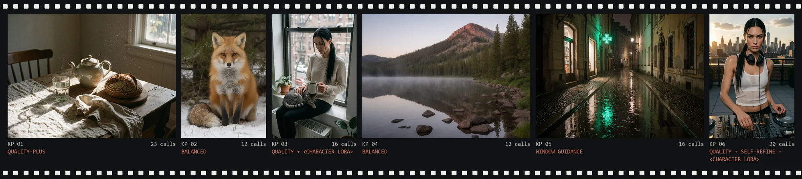
</p>

# KreaPhoton

**A sampler that develops Krea 2 Turbo images the way a darkroom develops film: compose, commit, re-expose, finish.**

Eleven ComfyUI nodes around one custom sampling loop, built for a CFG-distilled rectified-flow
model where the usual SD tricks either do nothing or break the picture. Every constant in the
presets was chosen by a measured test on real generations, and the tests that failed are written
down too.

`11 nodes` · `7 presets` · `16 model calls for quality` · `11 test files` · `244 bit-exact regression runs` · `MIT`

[The pack](#the-pack) · [How it samples](#how-it-samples) · [Presets](#presets) · [Controls](#what-each-control-moves) · [Finishing](#finishing) · [Lab notes](#lab-notes) · [Reference](#reference) · [Full technical reference](docs/REFERENCE.md)

<sub>All example frames: Krea 2 Turbo int8 merge checkpoint, 1.7 MP, one RTX 5090, 8–15 s each. The only person shown is one fictional character, rendered with a `<Character LoRA>`.</sub>

---

## The pack

The simple Sampler takes a seed, a preset and a variety level and computes everything else. The
Advanced node exposes every parameter of the same loop. The rest either prepares the run or
finishes the image.

| Node | Stage | What it does |
|---|---|---|
| **KreaPhoton Sampler** | sampling | Seed, preset, variety. Optional negative, phase models, coherence tools, composition blend, img2img denoise. |
| **Sampler (Advanced)** | sampling | The same loop with a SIGMAS input and every knob: detail envelope, gated eta, guidance policy, solver, predictor-corrector. |
| **Scheduler** | sampling | The analytic σ schedule: structure descent, plunge, restart jump, texture tail, optional self-refine pass. |
| **Empty Latent** | setup | Photo aspect ratios in four megapixel tiers for the 16-channel Krea 2 latent. |
| **Encode** | setup | Krea 2 native text encode with an optional calibrated style directive and an optional layout `think` block (manual / auto). |
| **LoRA Phase** | setup | Puts a LoRA on one phase of the trajectory: composition, identity or texture. Works on int8 and fp8 checkpoints. |
| **Composition Drafts** | preview | The first two model calls of several seeds as a contact sheet, a layout score, the best seed. |
| **Upscale v2** | finishing | Tiled ×2 refine with the same model; back-projection keeps the result true to the source. |
| **Upscale** | finishing | The original faithful upscaler, kept exactly as calibrated. |
| **Face Detailer** | finishing | Finds faces, redraws them at 1024 → 1536 px, checks identity with ArcFace, retries on drift. |
| **Save Image** | output | Folder picker, collision-free timestamped names, PNG / JPEG / WebP with metadata. |


## How it samples

Krea 2 Turbo is a rectified-flow model: the state is `x = (1 − σ)·image + σ·noise`, and σ runs from
1 to 0. KreaPhoton does not spread its steps evenly. It spends them where each decision is made,
then throws part of the result back into noise on purpose.

<picture>
  <source media="(prefers-color-scheme: dark)" srcset="docs/readme/schedule-dark.svg">
  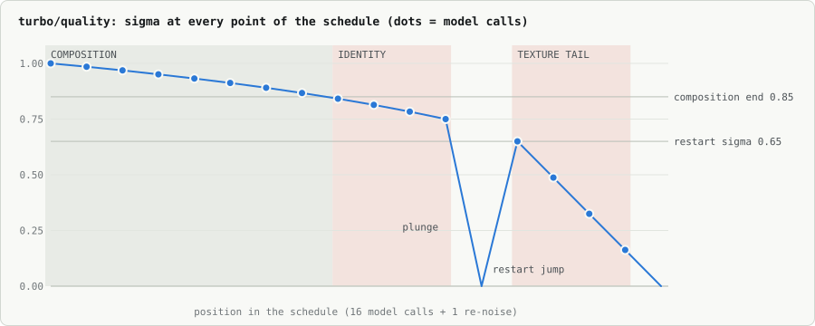
</picture>

| | Phase | σ · calls | What happens |
|---|---|---|---|
| 1 | **Composition** | 1.00 → 0.85 · 8 | Layout, framing and pose are decided from the initial noise field. Guidance with a negative acts here at full strength. The noise is contracted toward measured photo statistics (0.70 of unit amplitude): cleaner shadows, more variety between seeds. |
| 2 | **Identity** | 0.85 → 0.75 · 3 | Faces, bodies and clothing settle. The detail nudge peaks here: the model is asked about a slightly lower σ than the state has, which pushes it to commit to structure. A character LoRA on the identity phase takes over from this point. |
| 3 | **Plunge** | 0.75 → 0 · 1 | A distilled model reads out a whole image from mid-σ in one call. That readout is the draft. |
| 4 | **Restart** | 0 → 0.65 · none | The draft is thrown back into fresh noise with its own random stream. Anything re-noised below 0.75 can only change texture, so the composition survives. |
| 5 | **Texture** | 0.65 → 0 · 4 | The tail redraws skin, fabric and grain. Ancestral noise is gated off below σ 0.10, because noise injected at the very end turns dark areas blotchy. The v2 presets make this tail deterministic and second order. |

## Presets

<p align="center">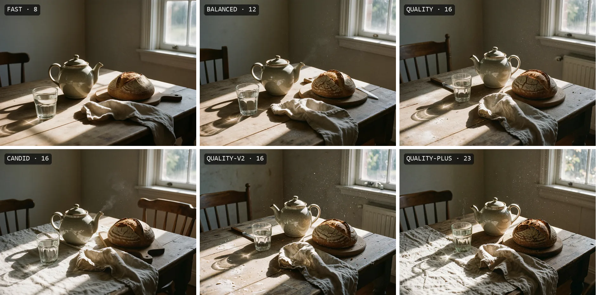</p>

Same prompt, same seed. The step count and the initial noise amplitude shape the structure phase,
so fast, balanced and candid set the table a little differently. quality and quality-v2 share every
structure step and differ only in how the surfaces are drawn. quality-plus redraws the identity
phase once more before the tail.

<p align="center">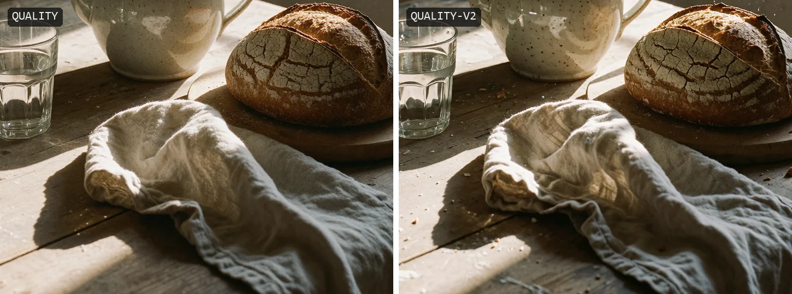</p>

**What v2 changes in the tail.** In the v1 presets every step of the texture tail is ancestral: it
removes noise and injects some back. **quality-v2** keeps that exploration in the structure phase
and makes the tail deterministic, integrated with a second-order solver (`rf_2m`). The composition
is identical by construction, only the tail differs. **quality-plus** adds a Heun correction at
three strategic steps and an adaptive self-refine pass. Native-resolution crop above.

## What each control moves

Each demo changes one input and keeps the prompt, the seed and everything else fixed.

### Variety

<p align="center">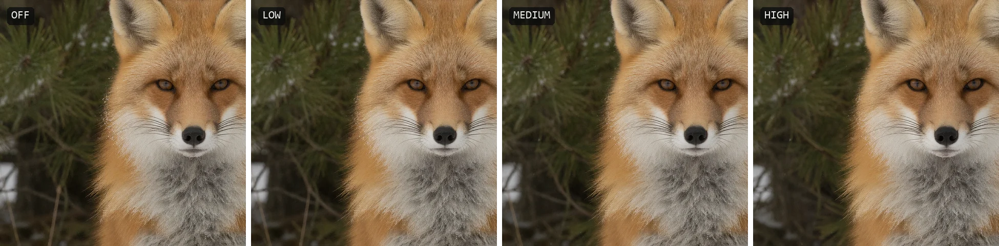</p>

Variety re-draws the low-frequency band of the noise at σ 0.96 and rotates part of the prompt
embedding. On this model a variance-preserving change cannot move the layout: the fox stays where
it sits. What changes is the texture realisation: fur, snow, the light on the frost. For a different
composition use a different seed or the composition blend. <sub>Sampler · variety off / low / medium / high · native crop</sub>

### Composition blend

<p align="center">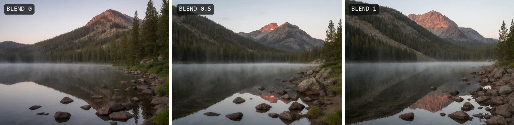</p>

On Krea 2 Turbo the layout lives in the initial noise field. `blend` interpolates that field
spherically between two seeds, so the midpoint is a new composition the model still develops into a
coherent photograph, not a double exposure. <sub>Sampler · seed 7003, seed_b 7103, blend 0 / 0.5 / 1</sub>

### Self-refine

<p align="center">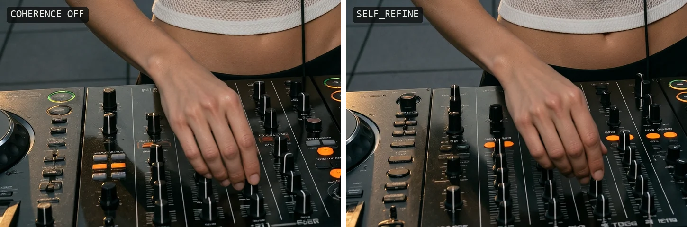</p>

After the plunge draft, `self_refine` puts the draft back into noise at σ 0.85 and lets the model
redraw the identity phase with the whole draft as a prior, then plunges again. It costs four more
model calls. The framing survives and the details are decided again: here the hand moved to another
fader and the controller was redrawn. Both versions of this hand are clean. The measured gain is on
hard cases: in the V21 test self-refine kept the composition in 7 of 7 scenes and turned a potter's
clay-covered hand into distinct fingers. <sub>Sampler · coherence off / self_refine · `<Character LoRA>` on the identity phase</sub>

### Detail nudge

<p align="center">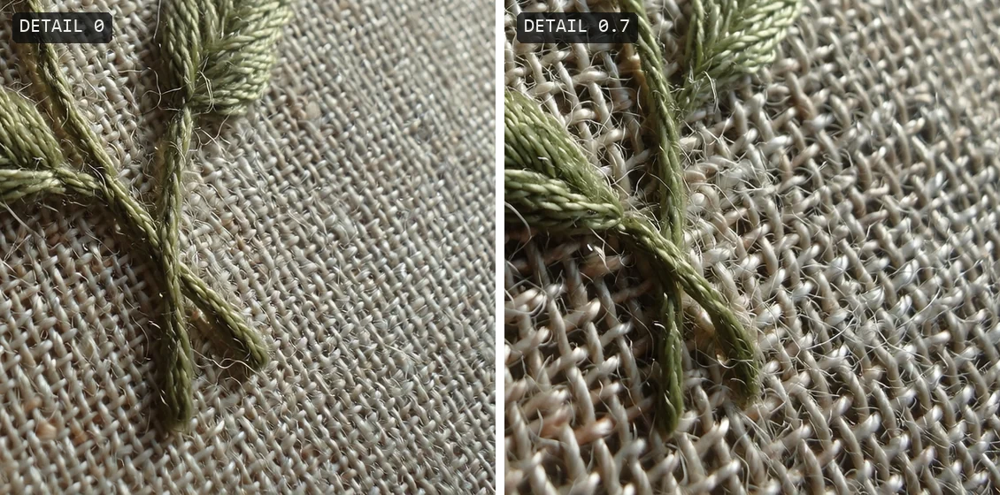</p>

At each structure step the model is queried at a slightly lower σ than the state carries,
`σ_model = σ − a·(σ − σ_next)`. It commits harder to edges and small forms. The strength follows an
envelope that peaks at the end of the structure phase and fades out before the texture tail.
<sub>Advanced · detail_amount 0 vs 0.7 · native crop</sub>

### Guidance policy

<p align="center">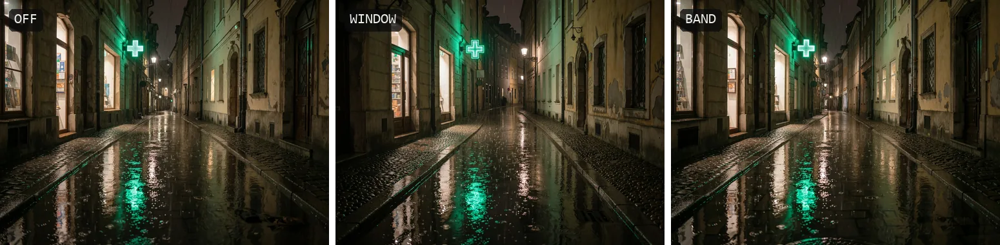</p>

<picture>
  <source media="(prefers-color-scheme: dark)" srcset="docs/readme/guidance-dark.svg">
  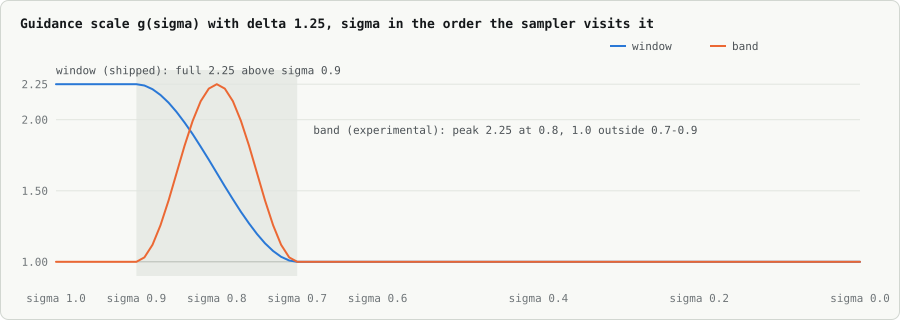
</picture>

Turbo is CFG-distilled, so classic full-run CFG breaks it. With a negative connected, KreaPhoton
guides only the high-σ part of the run. The shipped **window** policy is a ramp: nothing below σ 0.7,
full strength above 0.9, so it steers the composition head. The experimental **band** guides only
inside 0.7–0.9. On this street window reworks the scene compared with the unguided run, while band
stays close to it: the layout is already set before its range begins. Window gives the negative real
influence and costs an extra forward on 12 of 16 calls; band costs 6 and changes little.
<sub>Advanced · guidance_mode off / window / band · Δ 1.25 · negative: "blurry, low detail, cgi, plastic, oversaturated"</sub>

### LoRA Phase on a character

<p align="center">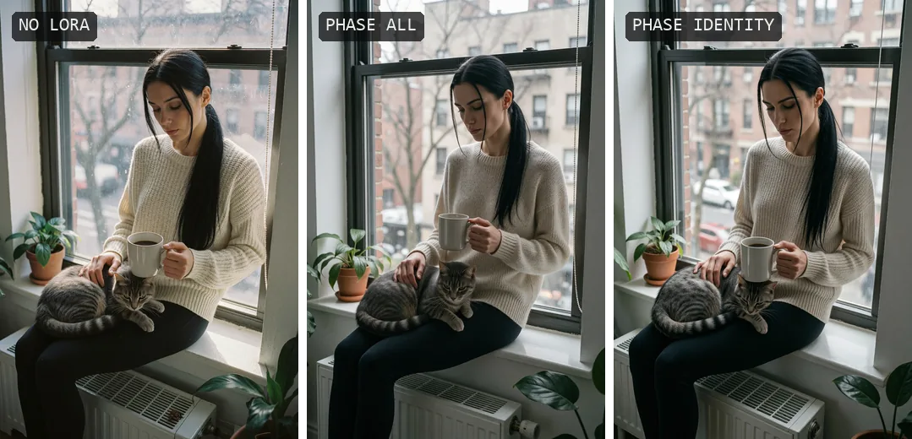</p>

A character LoRA loaded the usual way steers the whole run, including the layout. On the
**identity** phase it only takes over at σ 0.85, after the composition is decided. In this set the
identity-phase frame stays closer to what the base model composed than the all-phase frame does,
while both carry the character's face. The identity text alone gets the hair and the pose right,
but the face comes out softer and rounder. <sub>LoRA Phase · `<Character LoRA>` · none / all / identity · turbo/quality, seed 7008</sub>

## Finishing

### Upscale v2

<p align="center">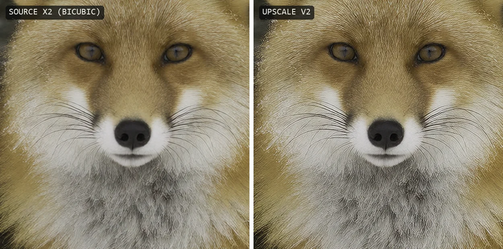</p>

×2 with an SR model as the base, then a light refine with the same Krea 2 model in overlapping tiles
that re-blend at every step. Back-projection makes the result reproduce the source exactly when
scaled back down, so tone, layout and shapes cannot drift. The model only adds what the source is
too small to hold. <sub>Upscale v2 · preset detail · scale 2 · 4xNomos8kSCHAT-L base · left: source enlarged with bicubic</sub>

### Face Detailer

<p align="center">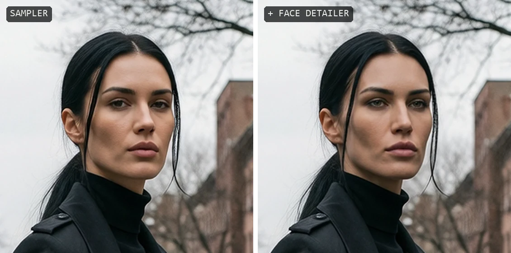</p>

In a full-body frame the face covers a few dozen pixels of the latent. The detailer crops it,
redraws it at 1024 → 1536 px with the same sampler on the texture model (identity LoRAs boosted
×1.5), compares the result with the original face in ArcFace, retries if the identity drifted, and
pastes it back through a feathered ellipse. <sub>Face Detailer · preset standard · `<Character LoRA>` on the identity phase · native crop</sub>

### Composition Drafts

<p align="center">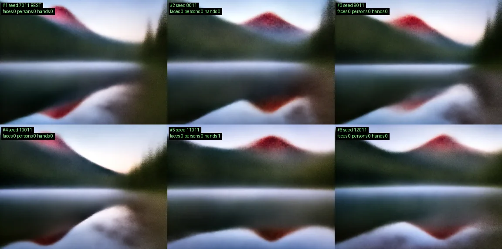</p>

The layout of the finished frame is decided by the first two model calls. Drafts runs only those
two for several seeds, reads out the draft and lays them on a contact sheet with a layout score, so
you pay for one full render instead of six. The chosen seed reproduces exactly in the Sampler.
<sub>Composition Drafts · 6 seeds × 2 calls · turbo/balanced</sub>

## Lab notes

Sampler v2 started as an external technical review. Every claim was checked against the code before
anything changed, and every new mechanism was tried on the live model before it shipped. Several
ideas did not survive.

**Found: `euler_2m` never ran as a two-step method.** With the presets' gated eta every model call
except the readouts is an ancestral step, and an ancestral step clears the multistep history. In
txt2img, turbo/quality was bit-for-bit plain Euler. The presets were calibrated in that state, so
they stay as they are. The new `rf_2m` solver only runs where a deterministic tail gives it two
steps in a row.

**Found: the guidance "window" is a ramp.** It is full strength above σ 0.9, which is how its budget
was designed and calibrated. The old README said guidance only acted inside 0.7–0.9 on 15–25 % of
steps. The telemetry shows 12 of 16 calls guided on quality.

**Rejected: maximum detail in the texture tail.** The review proposed putting the peak of the
detail nudge in the texture phase. At the preset strength that lays a coloured mesh over every
surface: the tail steps are nudged by up to 0.70 of a step and the model can no longer remove the
restart noise. The same failure appeared once before, in the S9 speckle bug. The σ-space envelope
keeps the old shape: peak at the end of the structure, zero below σ 0.55. Soft plunges longer than
one bridge step fail the same way and are capped at one.

<p align="center">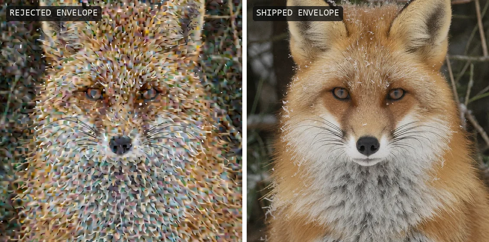</p>

<picture>
  <source media="(prefers-color-scheme: dark)" srcset="docs/readme/nudge-dark.svg">
  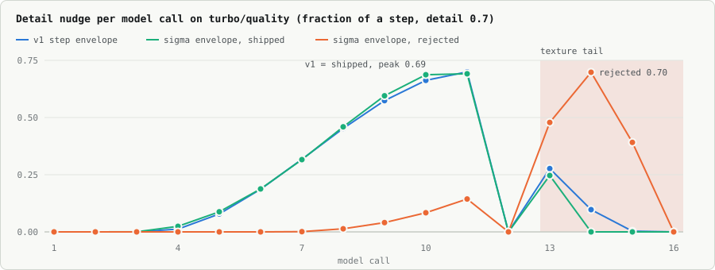
</picture>

**Measured: what the adaptive modes can and cannot see.** Fifteen calibration runs over six
categories. The x0 motion at the strategic steps separates a portrait (0.14) from hands, groups,
signage and full-body scenes (0.19–0.31), so `pc auto` corrects the complex ones. The draft's
mid-frequency motion (0.39–0.66) does not separate the scenes self-refine helps, so `refine auto`
keeps the pass on for ordinary content and skips only an unusually settled draft.

**Measured: small effects are reported as small.** Terminal x0 extrapolation at weight 0.3 changes
a portrait by about one level and does not raise its sharpness. Reading guidance at the true σ
instead of the nudged one changes about one level too. Both stay available and off.

**Every run reports what the loop did.** quality-plus on the still life at the top of the page:

```text
[KreaPhoton] solver=rf_2m calls=20 ancestral=14 euler=0 ab2=0 rf2m=1 readout=3 jumps=2
             history_resets=final:1 heun=2 pc_calls=3 refine=run(mf 0.454) guided=0/23
```

16 calls plus 4 for the self-refine pass, kept because the draft was still moving (0.454, above the
0.35 threshold); 14 ancestral steps in structure and refine, three readouts, two re-noise jumps, a
Heun-corrected first and last tail step with one second-order step between them, and three
corrector calls: 23 forwards in all.

## Reference

| preset | calls | solver | detail | restart | eta | noise | notes |
|---|---:|---|---:|---|---|---:|---|
| **turbo/fast** | 8 | euler | 0.50 | 0.25 · σ 0.65 · plunge | 1.0 gated | 0.70 | |
| **turbo/balanced** (default) | 12 | euler | 0.60 | 0.25 · σ 0.65 · plunge | 1.0 gated | 0.70 | |
| **turbo/quality** | 16 | euler_2m (runs as euler) | 0.70 | 0.25 · σ 0.65 · plunge | 1.0 gated | 0.70 | |
| **turbo/candid** | 16 | euler_2m (runs as euler) | 0.30 | 0.25 · σ 0.65 · plunge | 1.0 gated | 0.85 | softer, documentary |
| **turbo/quality-v2** | 16 | rf_2m | 0.70 | 0.25 · σ 0.65 · plunge | 1.0, tail 0 | 0.70 | experimental |
| **turbo/quality-plus** | 19–23 | rf_2m + Heun ×3 | 0.70 | 0.25 · σ 0.65 · plunge · refine auto | 1.0, tail 0 | 0.70 | experimental |
| **raw/experimental** | 36 | euler_2m | 0.50 | 0.20 · σ 0.45 | 1.0 gated | 1.00 | flat CFG 3.5, non-distilled RAW |

<sub>"noise" is the initial noise amplitude after contraction toward the photo manifold. Guidance on every Turbo preset: the window ramp with Δ 1.25, only when a negative is connected.</sub>

<details>
<summary><b>Sampler inputs</b></summary>

- `model`, `positive`, `latent_image`, `seed`, `preset`, `variety` off / low / medium / high, `preview_method`, `denoise` (below 1 = img2img refine on a clean partial descent)
- optional: `negative` (turns on window guidance for Turbo presets), `clean_model` and `texture_model` (phase models), `vae` for an on-node thumbnail, `seed_b` + `blend`, `restart_enhance`, `coherence` off / jump / self_refine / jump+self_refine

</details>

<details>
<summary><b>Sampler (Advanced) inputs</b></summary>

- `sigmas`, `sampler_order` euler / euler_2m / rf_2m, detail envelope (`detail_amount`, `detail_start/end/peak`), `eta0` + `sigma_gate`, `contraction`, `guidance_mode` off / flat / window / band, `flat_cfg`, `delta`, `guidance_lo/hi`, variety axes
- v1.3–v1.4: `x0_extrapolation`, `variety_seed`, `guidance_rescale`, `pag_*`, `restart_enhance`, `texture_model` + `texture_start`, `coherence_jump`
- Sampler v2: `eta_tail` (−1 off, 0 = deterministic restart tail), `guidance_sigma` model / true, `detail_space` step / sigma with `detail_sigma_hi/peak/lo`, `x0_extrap_order` 1 / 2, `x0_trust`, `pc` off / selective / auto, `refine_mode` on / auto. All default to the v1 behaviour.

</details>

<details>
<summary><b>Scheduler inputs</b></summary>

- `steps`, `alpha` (3.158 = the stock Krea 2 shift), `restart_frac`, `sigma_r`, `plunge` → SIGMAS. Model calls always equal `steps`.
- optional: `latent` (resolution-aware shift), `refine_steps` + `refine_sigma` (self-refine pass), `plunge_sigma` (the plunge floor), `soft_plunge` 0 / 1 (bridge 0.75 → 0.375 → 0)
- Restart schedules contain an ascending σ jump. Feed them only to KreaPhoton samplers.

</details>

<details>
<summary><b>Install and requirements</b></summary>

```sh
cd ComfyUI/custom_nodes
git clone https://github.com/Kostik2702/ComfyUI-KreaPhoton.git
```

- Restart ComfyUI. The samplers, scheduler, encode and upscalers need only torch and comfy.
- Face Detailer: `ultralytics` and `face_yolov8m.pt` (required), `insightface` + `onnxruntime` for the identity gate (optional).
- ComfyUI 0.2x–0.3x and a Krea 2 Turbo checkpoint; bf16, int8 and fp8 all work, LoRA plans included.
- Tests: `python_embeded/python.exe tests/run_tests.py` runs 11 plain-assert files under the embedded interpreter.

</details>

<details>
<summary><b>Known limits</b></summary>

- The validation domain is narrow: a few prompts and seeds per test, one official and one merge checkpoint.
- quality-v2, quality-plus and the Sampler v2 inputs are smoke-tested on the live model, not yet A/B-tested on a full set.
- Variety moves texture, not composition. Upscale cannot repair a deformed shape; any denoise that could redraw it rewrites the whole frame.
- The detail nudge must stay out of the region below σ ≈ 0.75 at preset strengths.
- The Save Image folder browser has no path allowlist. Keep ComfyUI local.

</details>

Every node input in detail, the calibration history behind each preset value and the changelog:
**[docs/REFERENCE.md](docs/REFERENCE.md)**.

## License

MIT
