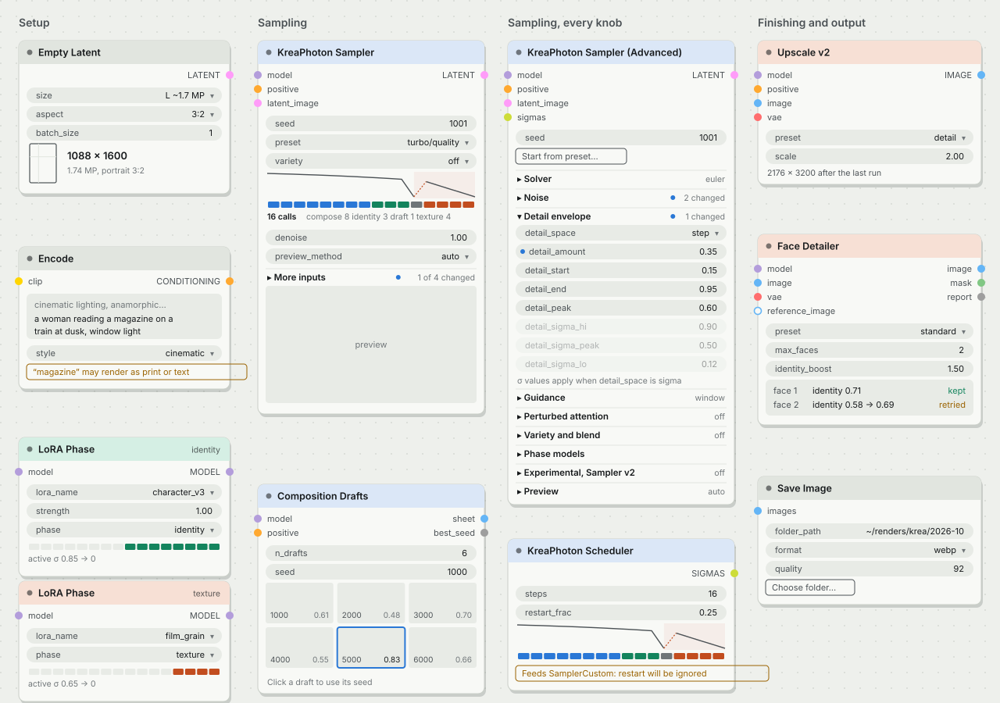
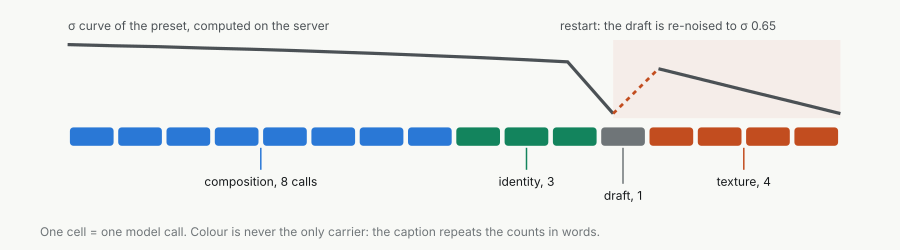

# KreaPhoton node UI: redesign concept

**Status:** concept, nothing implemented. **Date:** 2026-10-16. **Scope:** how the 11 nodes look and
behave on the ComfyUI canvas: colour, grouping, on-node readouts, copy, the one JS modal. Sampling
maths, presets and outputs stay as they are.

<picture>
  <source media="(prefers-color-scheme: dark)" srcset="node-board-dark.svg">
  
</picture>

Mockup, regenerated by `python3 docs/design/mockups.py docs/design`. Some widgets are left out
for space; the numbers in the readouts are illustrative except the σ strip, which is the real
`turbo/quality` schedule.

## In one paragraph

KreaPhoton already explains itself as a darkroom: compose, commit, re-expose, finish. The canvas
does not show any of that today. Every node is stock grey, all eleven sit in one flat category, and
the Advanced sampler is a single column of 43 widgets. The redesign does three things. It colours
each node by **the part of the σ trajectory it can change**, so the pipeline reads left to right
before any label is read. It puts one new visual element on the sampling nodes, the **σ strip**: a
miniature of the schedule with one cell per model call, coloured by phase. And it makes the
Advanced node navigable with sections, “changed” markers and dimmed inactive widgets, without
moving a single widget, so every saved workflow loads exactly as before.

---

## 1. What hurts today

Measured on `kreaphoton/nodes.py`, `face_detailer.py`, `composition.py`, `upscale_v2.py`,
`save.py` and `web/kreaphoton_save.js` at v1.8.0.

| # | Problem | Where | Effect on the user |
|---|---|---|---|
| 1 | All 11 nodes in one flat category `KreaPhoton`, alphabetical | every node, `CATEGORY` | The library does not show the order of use (setup → preview → sampling → finishing → output). |
| 2 | No node colour, no `DESCRIPTION`, no output tooltips | every node | On a 30-node workflow the pack is invisible; the node library preview has nothing to show. |
| 3 | Sampler (Advanced) is 43 widgets in one column, about 1,150 px tall (estimate: ~24 px per widget plus sockets) | `KreaPhotonSamplerAdvanced` | The ten Sampler v2 experimental knobs sit between stable ones; nothing says which values differ from a preset. |
| 4 | Widget dependencies are invisible | both samplers, Scheduler | `flat_cfg` does nothing unless `guidance_mode` is flat; `detail_sigma_*` do nothing while `detail_space` is step; `seed_b` does nothing at `blend` 0; `refine_steps` does nothing without `plunge`; `restart_enhance` needs a `vae`; `denoise` < 1 silently disables restart, blend and coherence. All of this lives only in tooltips. |
| 5 | A Scheduler with `restart_frac` > 0 breaks stock `SamplerCustom`; only the class docstring says so | `KreaPhotonScheduler` | A wrong wiring produces a bad image with no warning. |
| 6 | The Encode media-noun trap (“magazine”, “cover”, “poster” render as text or frames) is only a tooltip | `KreaPhotonEncode` | Users find it after a wasted render. |
| 7 | Tooltips carry lab shorthand: `docs/04 item 7`, `ZPhoton-proven`, `V5`, `V1-validated`, `V16b`, `V2-validated` | 5 tooltips in `nodes.py` | Readers outside the project cannot decode them, and `docs/04` is not in this repository. |
| 8 | Results that matter are only `STRING` outputs: the Face Detailer report, the Drafts scores | Face Detailer, Composition Drafts | You have to wire a text-display node to learn whether identity was kept. |
| 9 | The Save Image folder modal uses hard-coded colours, an emoji button label, no keyboard support | `web/kreaphoton_save.js` | It ignores the light theme and cannot be used without a mouse. |

What already works and stays: the on-node preview thumbnail (`vae` input), the per-node live
preview method, the folder picker route being read-only.

## 2. The idea

**Colour means the part of the trajectory a node can change.** The README draws the schedule with
a blue composition curve, a green identity curve and a safelight band around the restart. The nodes
take the same hues, so the README figures and the canvas speak one language:

| Family colour | Rule | Nodes |
|---|---|---|
| Composition blue | can change the layout (starts at σ 1.0) | Sampler, Sampler (Advanced), Scheduler, Composition Drafts |
| Identity green | acts from σ 0.85 down | LoRA Phase when `phase` is identity |
| Texture amber (safelight) | acts only below σ ≈ 0.65: cannot move layout or identity | Upscale v2, Upscale, Face Detailer, LoRA Phase when `phase` is texture |
| Graphite | outside the trajectory | Empty Latent, Encode, Save Image, LoRA Phase when `phase` is all |

LoRA Phase with `phase` composition takes blue. Its header follows the `phase` widget live, so a
chain of LoRA Phase nodes shows at a glance which LoRA steers what.

**One bold element, everything else quiet.** The σ strip is the memorable part. Headers are dark
tints, not saturated fills; bodies stay the theme's neutral; there are no icons, gradients or
emoji in titles. The node source badge ComfyUI already draws is the only branding.

**Show state, don't hide it.** Inactive widgets are dimmed, not hidden: they stay discoverable and
the node height does not jump when you change a combo.

## 3. Tokens

### Colour

Hues are taken from the README figures (`docs/readme/*-dark.svg` / `*-light.svg`). Contrast was
computed with the WCAG formula; headers carry the theme's title text.

| Token | Dark | Light | Use | Contrast |
|---|---|---|---|---|
| `phase.composition` | `#3987e5` | `#2a78d6` | σ strip cells, changed dots | 4.4 / 4.2 on body (graphics only, ≥ 3:1) |
| `phase.identity` | `#199e70` | `#13845d` | σ strip, “kept” | 4.7 / 4.4 |
| `phase.texture` | `#d95926` | `#c24d1f` | σ strip, restart marker | 4.1 / 4.5 |
| `phase.draft` | `#b3b9b5` | `#6f7578` | the plunge cell | 8.0 / 4.4 |
| `band.restart` | `#4a2a20` at 55 % | `#f3e3de` | safelight band behind the tail | decorative |
| `header.composition` | `#1f3f66` | `#dbe7f7` | node title bar | 9.2 / 14.3 with title text |
| `header.identity` | `#14503c` | `#d5efe4` | | 8.0 / 14.7 |
| `header.texture` | `#6e2f14` | `#f7e0d5` | | 8.6 / 14.1 |
| `header.neutral` | `#2b3032` | `#e1e5df` | | 11.4 / 14.8 |
| `warn` | `#e0a33a` | `#9a6200` | lint chips | text on body |

The full hues are used for graphics (cells, dots, strokes), never for body text below 14 px: as
text they sit just under 4.5:1 on the dark body.

### Type and spacing

- ComfyUI's own font everywhere; the pack ships no font.
- Numbers in readouts and the strip caption use `font-variant-numeric: tabular-nums`, so values do
  not jitter while dragging.
- Sentence case for every label, section and chip. No all-caps, no emoji.
- Widget ids stay snake_case (`detail_amount`): REFERENCE.md, the README and community posts use
  them. Friendly labels are a later, optional step (§ 9).
- DOM elements follow the canvas rhythm: 20 px widget height, 4 px gap, 10 px side inset, 6 px
  radius for panels, 4 px for chips.

## 4. Components

<picture>
  <source media="(prefers-color-scheme: dark)" srcset="sigma-strip-dark.svg">
  
</picture>

| Component | What it shows | Where |
|---|---|---|
| **σ strip** | The schedule the node will run: σ curve, restart band, one cell per model call coloured by phase, and a caption with the counts in words (“16 calls, compose 8, identity 3, draft 1, texture 4”). Self-refine adds visible cells; `denoise` < 1 switches to the refine descent and greys out the phases it skips. | Sampler, Scheduler; compact (cells only) on LoRA Phase with the active range in the node's colour |
| **Readout line** | One line of derived fact under the widgets that produce it: “1088 × 1600, 1.74 MP, portrait 3:2”; “2176 × 3200 after the last run”. | Empty Latent, Upscale v2 / Upscale |
| **Lint chip** | A non-blocking outlined note that names the problem and what happens: “‘magazine’ may render as print or text”; “Feeds SamplerCustom: restart will be ignored”; “restart_enhance needs a vae”. | Encode, Scheduler, Sampler |
| **Section header** | A collapsible group with a one-word summary on the right (“window”, “off”) or a count of changed widgets. | Sampler (Advanced); “More inputs” on the simple Sampler |
| **Changed dot** | A small composition-blue dot before a widget whose value differs from the reference (the default, or the preset chosen with “Start from preset”). | Sampler (Advanced) |
| **Dimmed widget** | 42 % opacity when the widget has no effect under the current values; one line under the group says why. | both samplers, Scheduler |
| **Report panel** | Result of the last run as rows: face, identity score, kept / retried. | Face Detailer |
| **Contact sheet** | The drafts with seed and layout score; the best one outlined; click to use a seed. | Composition Drafts |

## 5. Node by node

**Empty Latent** (graphite). An aspect frame with a rule-of-thirds hint and the readout
“1088 × 1600, 1.74 MP, portrait 3:2” under `size` / `aspect`. The pixel table comes from
`RESOLUTION_BUCKETS` through the UI data route (§ 7), never copied into JS.

**Encode** (graphite). The prompt box shows the active style directive as a faint first line, so
you see what the encoder actually receives. A lint chip appears when `text` or `custom_directive`
contains one of the media nouns krea2 renders literally (magazine, cover, snapshot, poster, photo,
print). The word list moves into one Python constant and is served to JS.

**LoRA Phase** (colour of its phase). Title-bar badge repeats the phase, so a collapsed node still
says it. Compact σ strip with the active range lit: composition 1.0 → 0.85, identity 0.85 → 0,
texture 0.65 → 0, all = every cell.

**KreaPhoton Sampler** (blue). Order unchanged: `seed`, `preset`, `variety`, then the σ strip,
then `preview_method`, `denoise`. The four optional widgets (`seed_b`, `blend`, `restart_enhance`,
`coherence`) go into a “More inputs” section, collapsed, with “1 of 4 changed” when something is
set. Optional sockets stay visible (sockets cannot be grouped). When `denoise` < 1 the strip shows
the refine descent and blend / coherence / restart_enhance dim with the line “Refine runs a plain
descent: restart, blend and coherence are skipped”.

**Sampler (Advanced)** (blue). Seed stays on top, then a “Start from preset…” button that copies a
preset's sampler-side values into the widgets and becomes the reference for the changed dots. The
43 widgets fall into ten sections (§ 6). Default: all collapsed except the one holding the most
recently changed widget. Target height with sections collapsed: ≤ 560 px (from about 1,150).

**Scheduler** (blue). Full σ strip computed from its own widgets. Lint chips: `refine_steps` > 0
without `plunge` (“Self-refine needs plunge”), and a SIGMAS output linked to anything that is not a
KreaPhoton sampler while `restart_frac` > 0 (“Feeds SamplerCustom: restart will be ignored”).

**Composition Drafts** (blue: it runs only the composition phase). The sheet becomes an on-node
contact sheet: seed bottom-left, layout score bottom-right, best draft outlined in composition blue.
Clicking a draft uses its seed (mechanism is an open question, § 10).

**Upscale v2 / Upscale** (amber). Readout of the target size after the last run. The original node
is renamed in display only to “KreaPhoton Upscale (classic)” so the library shows which one to pick
first; it is not marked deprecated, because it stays calibrated and supported.

**Face Detailer** (amber). Report panel from the last run: one row per face, identity score, kept /
retried / skipped, in identity green or warn amber plus the word, so colour is never the only
signal. The `report` STRING output stays for downstream use.

**Save Image** (graphite). The button reads “Choose folder…”. The modal is rebuilt on the same tokens
and theme variables: clickable breadcrumb segments, ↑ ↓ to move, Enter to open, Backspace to go up,
Esc to close, focus trapped inside, a short list of recent folders kept in `localStorage`. The route
stays read-only: no “new folder” button.

## 6. Sampler (Advanced): sections and relevance

No widget moves. Sections are drawn by JS around the existing order, so the grouping below is a
visual overlay on the frozen list.

| Section | Widgets | Summary shown when collapsed |
|---|---|---|
| Solver | `sampler_order`, `x0_extrapolation`, `x0_extrap_order`, `x0_trust`, `pc` | solver name |
| Noise | `eta0`, `sigma_gate`, `eta_tail`, `contraction`, `per_channel_contraction` | changed count |
| Detail envelope | `detail_amount`, `detail_space`, `detail_start`, `detail_end`, `detail_peak`, `detail_sigma_hi`, `detail_sigma_peak`, `detail_sigma_lo` | changed count |
| Guidance | `guidance_mode`, `flat_cfg`, `delta`, `guidance_lo`, `guidance_hi`, `guidance_rescale`, `guidance_sigma` | mode |
| Perturbed attention | `pag_scale`, `pag_lo`, `pag_hi`, `pag_blocks` | off / scale |
| Variety and blend | `variety_a_latent`, `variety_a_cond`, `variety_end`, `variety_seed`, `seed_b`, `blend` | off / on |
| Coherence | `coherence_jump`, `coherence_jump_sigma`, `refine_mode` | off / jump |
| Phase models | `composition_end`, `texture_start`, `restart_enhance` | connected models |
| Preview | `preview_method` | method |
| (top, always open) | `seed` | |

That is 42 widgets in sections plus `seed`: 43. Experimental Sampler v2 widgets (`eta_tail`,
`guidance_sigma`, `detail_space`, `detail_sigma_*`, `x0_extrap_order`, `x0_trust`, `pc`,
`refine_mode`) keep their place in their section and carry a small “experimental” tag; they do not
get their own section, because grouping by what a knob does is what users search by.

**Relevance rules** (widget dims when the condition is false):

| Widget | Has an effect when |
|---|---|
| `flat_cfg` | `guidance_mode` is flat |
| `delta`, `guidance_lo`, `guidance_hi` | `guidance_mode` is window or band |
| `guidance_sigma` | `guidance_mode` is window or band, or `pag_scale` > 0 (it also moves the PAG gate) |
| `detail_start`, `detail_end`, `detail_peak` | `detail_space` is step |
| `detail_sigma_hi`, `detail_sigma_peak`, `detail_sigma_lo` | `detail_space` is sigma |
| `x0_extrap_order`, `x0_trust` | `x0_extrapolation` > 0 |
| `pag_lo`, `pag_hi`, `pag_blocks` | `pag_scale` > 0 |
| `coherence_jump_sigma` | `coherence_jump` > 0 |
| `seed_b` | `blend` > 0 |
| `variety_end`, `variety_seed` | `variety_a_latent` or `variety_a_cond` > 0 |
| `texture_start` | a texture model exists: `texture_model` connected, or a LoRA Phase with phase texture upstream on `model` (`plan_segments` cuts only with `has_texture`) |

Deliberately **not** in the table, after checking `sampling.py`: `composition_end` (it also places
the predictor-corrector step and the refine `auto` anchor, so it matters without `clean_model`),
and `restart_enhance` (without a `vae` it is an error, not a no-op, so it gets a lint chip instead
of dimming). A rule that is not certain is left out: a wrongly dimmed widget is worse than none.
The rules live in one Python table served to JS, with a unit test per rule.

## 7. Engineering constraints

These decide the architecture more than taste does.

1. **Widget order is frozen.** A saved workflow stores widget values as a positional list
   (`widgets_values`). Reordering, renaming or removing a widget shifts every later value in every
   existing workflow. New widgets may only be appended at the end of `optional`. A unit test freezes
   the ordered widget list of all 11 nodes; it is proven by planting a swap and watching it fail.
2. **Two renderers.** The ComfyUI frontend draws nodes on the LiteGraph canvas, and newer versions
   offer a Vue-based node renderer. Information must not depend on custom canvas painting
   (`onDrawForeground`): the σ strip, readouts, chips and panels are DOM widgets, colours are the
   standard `color` / `bgcolor`. Canvas painting may only add polish.
3. **One source for the maths.** JS never re-implements the schedule. A read-only route
   `GET /kreaphoton/schedule?preset=…&coherence=…&denoise=…&w=…&h=…` calls `build_schedule` /
   `refine_schedule` and returns σ values, phase per call and counts. A second route
   `GET /kreaphoton/ui` returns static data: resolution buckets, preset summaries, LoRA phase
   ranges, media nouns, relevance rules. Both live in `server_routes.py` next to `/browse`.
   When the latent size is unknown at edit time, the strip uses an Empty Latent found upstream, or
   the L tier, and says which in its caption.
4. **Colours get saved into workflows.** LiteGraph serialises a node's `color` / `bgcolor`. The
   extension sets them only on nodes with no colour, and records `properties.kp_palette = 1`, so a
   later palette update recolours its own nodes and never a colour the user chose. A setting turns
   pack colours off.
5. **Python-only users see no change.** Headless and API runs ignore all of this. Result panels need
   a `ui` payload next to the outputs (as the preview thumbnail already does); outputs and the
   bit-exact regression runs do not change.
6. **Settings** (ComfyUI settings panel, “KreaPhoton” group): node colours on / off; σ strip on /
   off; Advanced sections collapsed by default on / off.
7. **No new dependencies, no network beyond the local routes, no fonts.**

## 8. Copy

**Node descriptions** (`DESCRIPTION`, shown in the node library preview):

| Node | Description |
|---|---|
| Sampler | Generates a Krea 2 Turbo image from a preset: seed, preset and variety, everything else computed. |
| Sampler (Advanced) | The same sampling loop with every parameter exposed. Takes a SIGMAS schedule. |
| Scheduler | Builds the σ schedule: structure descent, draft, restart and texture tail. Only KreaPhoton samplers understand the restart. |
| Empty Latent | An empty Krea 2 latent in photo aspect ratios, four megapixel sizes. |
| Encode | Krea 2 text encode with an optional style directive in front of the prompt. |
| LoRA Phase | Applies a LoRA only during one phase: composition, identity or texture. Chain one per LoRA. |
| Composition Drafts | Renders the first model calls of several seeds as a contact sheet and picks the best layout. |
| Upscale v2 | Upscales ×1.25 to ×2 and redraws fine texture with the same model; the result stays true to the source. |
| Upscale (classic) | The original faithful upscaler, kept as calibrated. |
| Face Detailer | Finds faces, redraws them at higher resolution and checks the identity is kept; retries on drift. |
| Save Image | Saves to any folder with collision-free names, as PNG, JPEG or WebP with metadata. |

**Tooltip shape.** First sentence: what it changes in the picture. Second: the useful range and
the default. Then “Experimental” if it is, and the cost if any (“+1 model call per step”).
Measurement history, internal ids and dates move to REFERENCE.md. Example, `clean_model`:

> Before: “Optional: composition phase (sigma > composition_end) runs on this clean checkpoint, LoRA
> identity/detail phase on `model` (anti-mutation, ZPhoton-proven pattern; unvalidated on krea2 LoRA
> stacks per docs/04 item 7). EXPERIMENTAL: …”
>
> After: “Runs the composition phase on this model instead of `model`, so a character LoRA cannot
> steer the layout. Experimental: not yet validated with Krea 2 LoRA stacks. Forces eta0 to 0.”

Also: `OUTPUT_TOOLTIPS` for every output; `SEARCH_ALIASES` such as “krea sampler”, “restart
sampler”, “face fix”, “lora by phase”.

**Categories** (library order follows the pipeline, which is a real sequence, so numbers are
justified): `KreaPhoton/1 Setup`, `KreaPhoton/2 Preview`, `KreaPhoton/3 Sampling`,
`KreaPhoton/4 Finishing`, `KreaPhoton/5 Output`. Category and display name are not stored in
workflows, so both changes are safe.

## 9. Rollout

| Phase | Content | Risk | Done when |
|---|---|---|---|
| P0 | Python metadata only: categories, `DESCRIPTION`, `OUTPUT_TOOLTIPS`, `SEARCH_ALIASES`, tooltip rewrite, “Upscale (classic)” display name, the widget-order freeze test | none for workflows | the freeze test fails on a planted swap and passes on master; old workflows load with identical values |
| P1 | JS theme: family colours with `kp_palette`, live LoRA Phase colour, settings, Save modal rebuilt with keyboard support | low | both themes checked by screenshot; user-coloured nodes untouched after reload |
| P2 | Routes `/kreaphoton/ui` and `/kreaphoton/schedule`; σ strip on Sampler, Scheduler, LoRA Phase; Empty Latent readout; Encode and Scheduler lint chips | medium (new routes) | strip counts equal the model-call counts the sampler logs for every preset |
| P3 | Advanced sections, changed dots, relevance dimming, “Start from preset…”; “More inputs” on the simple Sampler | medium (most JS) | Advanced ≤ 560 px collapsed; every relevance rule has a test |
| P4 | Result panels (Face Detailer report, Upscale size), clickable contact sheet, `example_workflows/` with thumbnails for the Templates browser | low | panels render after a run in both renderers |
| P5 (optional) | Friendly widget labels, if the frontend supports display names without touching ids | unknown | |

Each phase ships on its own; P0 alone already fixes problems 1, 2 and 7.

## 10. Before coding: what to verify

Nothing in ComfyUI was run for this concept (no ComfyUI install on this machine). Each item below is
an assumption about the frontend to confirm on the version the pack targets, before the phase that
needs it:

- `DESCRIPTION`, `OUTPUT_TOOLTIPS`, `SEARCH_ALIASES` on V1 node classes are shown by the current
  frontend (P0).
- A node's title is saved into the workflow only when the user edited it, so renaming the display
  name (“Upscale (classic)”) reaches old workflows; deprecated nodes are hidden from search by
  default (P0, and the reason for § 11).
- `node.color` / `node.bgcolor` are honoured by the Vue node renderer, and how the active palette's
  light / dark flag is read from JS (P1).
- Extension `settings` registration and the theme CSS variables (`--fg-color`, `--comfy-input-bg`,
  `--border-color`, `--descrip-text`) (P1).
- `addDOMWidget` sizing and rendering in both renderers; whether widgets can be dimmed and hidden
  without breaking `widgets_values` (P2, P3).
- `example_workflows/` in a custom node folder appears in the Templates browser (P4).

## 11. Considered and rejected

- **Reordering inputs into logical groups.** Breaks every saved workflow (§ 7.1).
- **Hiding inactive widgets.** Node height jumps on every combo change and the knob disappears from
  view; dimming keeps both stable.
- **Painting the whole node body on the canvas.** Invisible in the Vue renderer; DOM widgets work
  in both.
- **A separate “Experimental” section on Advanced.** Users look for a knob by what it does; an
  “experimental” tag in place keeps that.
- **Saturated header fills, icons or emoji in titles, a logo.** Competes with the σ strip, which is
  the one element that carries information no other pack shows.
- **Marking Upscale (classic) deprecated.** It is still the calibrated reference; the frontend
  would hide it from search.

## 12. Open questions for the owner

**Status: OPEN** (recorded 2026-10-16; the owner chose to keep them open for now). None of them
blocks P0–P2; each must be decided before the phase named next to it.

| # | Question | Options | Blocks |
|---|---|---|---|
| Q1 | What does a click on a draft in Composition Drafts do? | copy the seed to the clipboard; or an optional `pick_seed` widget (appended at the end, so safe for workflows) that overrides `best_seed` on the next run | P4 |
| Q2 | Should “Start from preset…” on Advanced also fill a connected Scheduler? | sampler-side widgets only; or sampler and the connected Scheduler | P3 |
| Q3 | Keep snake_case widget ids visible permanently? | keep ids; or friendly labels with the id in the tooltip | P5 |
